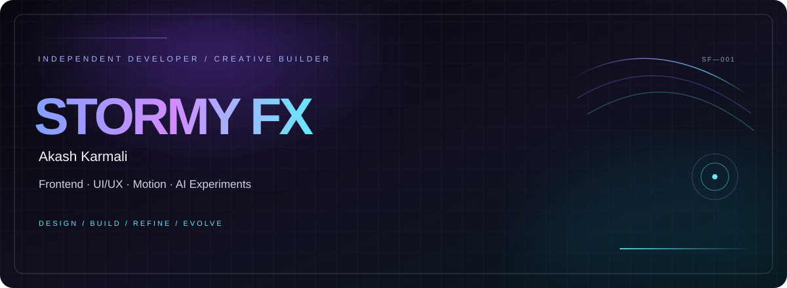
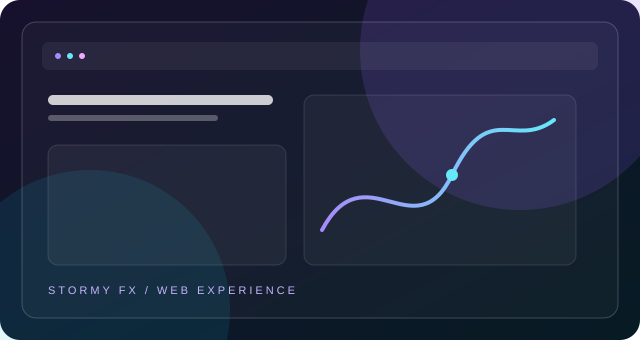
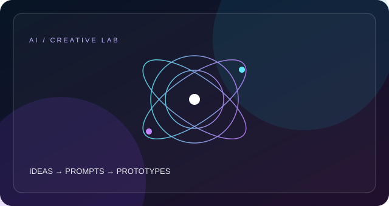
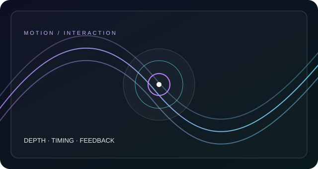

**DESIGN WITH INTENTION · ENGINEER WITH PRECISION · KEEP EVOLVING**

## `01 / ABOUT ME`

<table>
<tr>
<td width="62%" valign="top">

### Hey, I'm Akash — aka **STORMY FX**. 👋

I'm a student and independent builder from **Odisha, India**, exploring frontend development, UI/UX, motion design, and AI-assisted creativity.

I enjoy turning ideas into responsive websites with clear structure, distinctive visual direction, and thoughtful details. I learn by building, testing, and improving projects one iteration at a time.

My goal is to develop strong web engineering fundamentals while creating digital experiences that feel polished, useful, and memorable.

</td>
<td width="38%" valign="top">

### `QUICK PROFILE`

| FIELD | DETAILS |
|---|---|
| Identity | STORMY FX |
| Name | Akash Karmali |
| Location | Odisha, India |
| Focus | Frontend & UI/UX |
| Exploring | AI & creative coding |
| Mindset | Learn · Build · Refine |

</td>
</tr>
</table>

## `02 / WHAT I EXPLORE`

<table>
<tr>
<td width="50%" valign="top">

### ◈ Frontend development
Responsive websites, semantic HTML, modern CSS, JavaScript interactions, and reusable interface patterns.

### ◈ UI/UX design
Visual hierarchy, layout composition, typography, responsive behaviour, and consistent design systems.

</td>
<td width="50%" valign="top">

### ◈ Motion & visual design
Micro-interactions, cinematic visual direction, gradients, layered compositions, and motion concepts.

### ◈ AI experiments
Prompt engineering, AI-assisted development, rapid prototyping, and creative tool exploration.

</td>
</tr>
</table>

## `03 / FEATURED PROJECTS`

<table>
<tr>
<td width="50%" valign="top">

### `01 — Business web experiences`

Responsive websites for local businesses and service providers, with clear content and polished presentation.

`HTML` · `CSS` · `JavaScript`

[Explore repositories ↗](https://github.com/stormy-fx?tab=repositories)

</td>
<td width="50%" valign="top">

### `02 — AI & creative lab`

Exploring AI-assisted workflows, prompt engineering, and ways to turn ideas into practical prototypes.

`AI tools` · `Prompting` · `Prototyping`

[Explore repositories ↗](https://github.com/stormy-fx?tab=repositories)

</td>
</tr>
<tr>
<td width="50%" valign="top">

### `03 — Motion-led interfaces`

Experimenting with visual depth, interaction states, transitions, and immersive web design.

`UI/UX` · `Motion concepts` · `Visual systems`

[Explore repositories ↗](https://github.com/stormy-fx?tab=repositories)

</td>
<td width="50%" valign="top">

### `04 — Learning in public`

Practice builds and experiments to strengthen fundamentals, test ideas, and improve the craft.

`Practice` · `Iteration` · `Growth`

[View all repositories ↗](https://github.com/stormy-fx?tab=repositories)

</td>
</tr>
</table>

Project tiles currently use original decorative artwork. Replace each title, description, and link with the corresponding real project when you are ready.

## `04 / TECH TOOLKIT`

Keep only tools you actually use or are actively learning.

## `05 / BUILD PROCESS`

**01 DISCOVER**　→　**02 DESIGN**　→　**03 BUILD**　→　**04 REFINE**

Understand the goal. Shape the experience. Build the interface. Test and improve the details.

## `06 / GITHUB ANALYTICS`

## `07 / CONTRIBUTION SNAKE`

Requires a workflow that publishes this exact SVG path. Preserve your current working snake URL if it differs.

## `08 / CURRENT FOCUS`

## `09 / BEYOND CODE`

Gaming, cinematic visuals, creative software, and emerging technology all influence my visual taste and encourage me to experiment with new ideas.

## `10 / CONNECT`

If you're interested in web design, creative technology, or exchanging ideas, find me on GitHub.

STORMY FX · AKASH KARMALI · ODISHA, INDIA

**CREATE / REFINE / EVOLVE**

