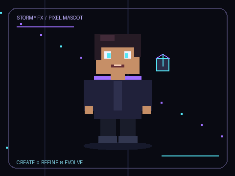

<!--
  STORMY FX — GitHub Profile README
  Repository: stormy-fx/stormy-fx
-->

<div align="center">



# ⚡ STORMY FX

### `AKASH KARMALI` · DEVELOPER · CREATIVE BUILDER


<br/>

<a href="https://github.com/stormy-fx">
  
</a>


<br/><br/>

*I build, experiment, and learn at the intersection of web development, visual design, animation, and AI.*

</div>

---

## `01 / ABOUT ME`

```js
const stormyFX = {
  name: "Akash Karmali",
  alias: "STORMY FX",
  location: "Odisha, India",
  role: "Student & Independent Builder",

  interests: [
    "Frontend Development",
    "Creative UI/UX",
    "Web Animations",
    "Artificial Intelligence",
    "Interactive Experiences"
  ],

  currentlyLearning: [
    "Writing cleaner code",
    "Building responsive websites",
    "Improving design systems",
    "Exploring AI-powered workflows"
  ],

  philosophy: "Build it. Break it. Learn. Improve."
};
```

- ⚡ Creating modern, responsive, and visually engaging websites.
- 🎨 Exploring dark interfaces, cinematic visuals, motion, and micro-interactions.
- 🤖 Experimenting with AI tools to accelerate creative and technical workflows.
- 🧩 Turning concepts into practical projects and continuously improving my skills.
- 🚀 Working toward becoming a stronger developer, designer, and independent creator.

---

## `02 / WHAT I DO`

<table>
<tr>
<td width="50%" valign="top">

### 🌐 Web Development

Building responsive websites with modern layouts, clean structure, and interactive elements.

- Landing pages
- Business websites
- Portfolio websites
- Interactive web experiences

</td>
<td width="50%" valign="top">

### 🎨 UI/UX & Motion

Exploring the visual details that make digital products feel polished and engaging.

- Dark and neon interfaces
- Glass-inspired UI
- Smooth animations
- Responsive design systems

</td>
</tr>
<tr>
<td width="50%" valign="top">

### 🤖 AI & Automation

Using AI-assisted workflows to explore ideas, generate prototypes, and solve problems.

- AI-assisted development
- Prompt engineering
- Creative experimentation
- Workflow automation

</td>
<td width="50%" valign="top">

### 🕹️ Creative Technology

Combining code, graphics, and interaction to create distinctive digital experiences.

- Interactive experiments
- Gaming-inspired visuals
- Pixel-art aesthetics
- Web-based prototypes

</td>
</tr>
</table>

---

## `03 / TECH STACK`

<div align="center">

### Languages & Web


### Tools & Platforms


</div>

> My stack evolves as I learn. These icons represent technologies and tools I explore or use; they are not a claim of expert-level proficiency in every one.

---

## `04 / FEATURED PROJECTS`

<div align="center">

<a href="https://github.com/stormy-fx?tab=repositories">
  
</a>

</div>

### 🔭 What I'm interested in building

| Project type | Goal |
|---|---|
| 🌐 Business websites | Create polished websites for real-world businesses. |
| ✨ Interactive portfolios | Showcase work through modern layouts and motion. |
| 🤖 AI-powered tools | Experiment with useful AI-driven experiences. |
| 🎮 Creative web projects | Explore gaming-inspired visuals and interactive ideas. |

**Explore my actual projects:** [github.com/stormy-fx](https://github.com/stormy-fx)

---

## `05 / GITHUB ANALYTICS`

<div align="center">

<a href="https://github.com/stormy-fx">
  
</a>

<a href="https://github.com/stormy-fx">
  
</a>

<br/>

<a href="https://streak-stats.demolab.com/?user=stormy-fx">
  
</a>

</div>

<sub>Statistics are generated by external services and may take time to update. Language statistics describe detected repository code, not overall proficiency.</sub>

---

## `06 / CONTRIBUTION SNAKE`

<div align="center">


</div>

<sub>For this animation to appear, configure a GitHub Actions workflow that generates the snake and publishes the resulting SVG to the repository's `output` branch. This is separate from the mascot workflow.</sub>

---

## `07 / CURRENT MINDSET`

<div align="center">

### `DESIGN WITH INTENT. CODE WITH PURPOSE.`

```text
[ LEARN ] ──> [ BUILD ] ──> [ TEST ] ──> [ IMPROVE ]
    ^                                      |
    └──────────────────────────────────────┘
```

Every project is an opportunity to learn something new, improve the details, and make the next version better.

</div>

---

## `08 / CONNECT`

<div align="center">

<a href="https://github.com/stormy-fx">
  
</a>

<br/><br/>

**Interested in websites, creative development, or AI-powered ideas?**

Explore my repositories and follow along as I build.

<br/>


<br/><br/>


### ⚡ STORMY FX

*Create · Refine · Evolve*

</div>
