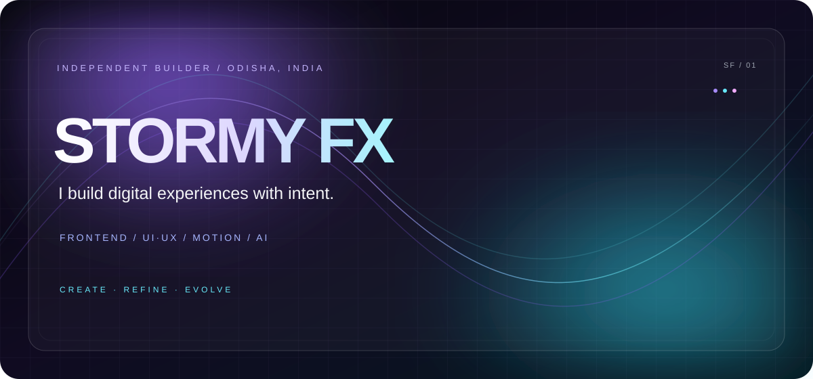
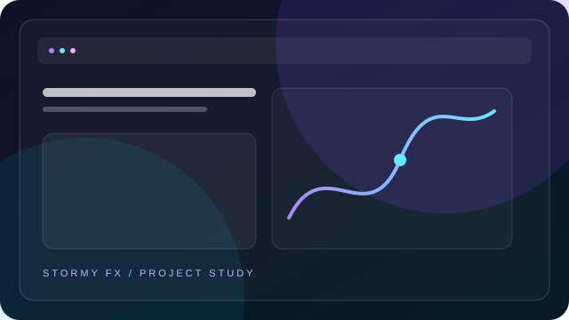

**DESIGN WITH INTENTION · ENGINEER WITH PRECISION · KEEP EVOLVING**

## `01 / IDENTITY — BEHIND THE PIXELS`

<table>
<tr>
<td width="62%" valign="top">

### Hey, I'm Akash Karmali — aka **STORMY FX**. 👋

I'm a student and independent digital builder from **Odisha, India**, exploring the space between frontend development, UI/UX, motion design, and AI-assisted creativity.

I enjoy taking an idea from a rough concept to a working interface: shaping the layout, refining the visual language, adding meaningful interactions, and polishing the small details that make a digital experience feel intentional.

My approach is to learn by building. Each project is a chance to improve my code, sharpen my design eye, and understand how better experiences are made.

**The direction:** create useful websites with a distinct visual identity — not just pages that look good in a screenshot.

</td>
<td width="38%" valign="top">

### `PROFILE / LIVE NOTES`

| FIELD | DETAILS |
|---|---|
| Identity | STORMY FX |
| Name | Akash Karmali |
| Base | Odisha, India |
| Current chapter | Student · Independent builder |
| Main focus | Frontend & UI/UX |
| Creative interests | Motion · AI · visual systems |
| Mindset | Learn → Build → Refine |

</td>
</tr>
</table>

## `02 / THE CREATIVE STACK`

<table>
<tr>
<td width="50%" valign="top">

### ◈ Frontend craft

- Responsive website structure
- HTML, CSS, and JavaScript
- Layout, spacing, and typography
- Reusable interface patterns
- Practical, maintainable implementation

### ◈ Interface design

- Dark, cinematic visual systems
- Glass-inspired surfaces
- Strong hierarchy and composition
- Mobile-first layout thinking
- Clear navigation and user journeys

</td>
<td width="50%" valign="top">

### ◈ Motion & interaction

- Scroll-led reveals
- Hover states and micro-interactions
- Layered visual depth
- Parallax-inspired composition
- Motion that supports usability

### ◈ AI & experimentation

- Prompt engineering
- AI-assisted coding workflows
- Rapid prototypes
- Creative tool exploration
- Testing ideas through small builds

</td>
</tr>
</table>

## `03 / SELECTED WORK — PROJECT UNIVERSE`

> These are portfolio categories based on the kinds of work I'm exploring. Add your exact deployed links and repository URLs to turn each item into a verified case study.

<table>
<tr>
<td width="50%" valign="top">

### `01 — Business web experiences`

**The objective:** help businesses present their services clearly and professionally online.

Exploring responsive websites for local businesses, service providers, restaurants, and clinics — with clear content structure and thoughtful visual design.

`HTML` `CSS` `JavaScript` `Responsive UI`

[Browse repositories ↗](https://github.com/vivekananda-school/vivekananda-school?tab=repositories)

</td>
<td width="50%" valign="top">

### `02 — Cinematic interface studies`

**The objective:** make a web experience feel immersive without sacrificing clarity.

Dark themes, editorial typography, ambient gradients, glass-inspired layers, and deliberate transitions.

`Visual systems` `UI/UX` `Motion concepts`

[Browse repositories ↗](https://github.com/vivekananda-school/vivekananda-school?tab=repositories)

</td>
</tr>
<tr>
<td width="50%" valign="top">

### `03 — AI creative experiments`

**The objective:** explore faster ways to move from an idea to a prototype.

Prompt workflows, AI-assisted development, model exploration, and experiments that connect creativity with useful tools.

`AI tools` `Prompting` `Prototyping`

[Browse repositories ↗](https://github.com/vivekananda-school/vivekananda-school?tab=repositories)

</td>
<td width="50%" valign="top">

### `04 — Learning in public`

**The objective:** keep a visible record of progress through real builds.

Practice projects, interface experiments, and increasingly ambitious ideas — reviewed, improved, and rebuilt as my skills develop.

`Practice` `Iteration` `Continuous learning`

[Browse all repositories ↗](https://github.com/vivekananda-school/vivekananda-school?tab=repositories)

</td>
</tr>
</table>

### Project case-study format

For each real project you add, aim to document:

- **Problem:** what the project was meant to solve.
- **Approach:** how you structured and designed it.
- **Highlights:** the features or details worth noticing.
- **Stack:** the technologies actually used.
- **Outcome:** what works, what you learned, and what you would improve.

## `04 / TECHNOLOGIES & TOOLS`

**WEB DEVELOPMENT**

**DESIGN / MOTION / PROTOTYPING**

**CURRENT EXPLORATION**

`Modern CSS` · `JavaScript interactions` · `UI/UX systems` · `AI-assisted workflows` · `Creative coding`

This is an exploration map, not a claim of expert-level proficiency in every tool. Add or remove icons to reflect your current hands-on experience.

## `05 / BUILD PHILOSOPHY`

<table>
<tr>
<td width="33%" align="center" valign="top">

### `01 / CLARITY`

Start with the goal. Make the content and user journey understandable.

</td>
<td width="34%" align="center" valign="top">

### `02 / CRAFT`

Give typography, spacing, motion, and responsive behaviour the attention they deserve.

</td>
<td width="33%" align="center" valign="top">

### `03 / ITERATION`

Test the result, find weak spots, and refine instead of stopping at the first version.

</td>
</tr>
</table>

## `06 / WHAT I'M WORKING TOWARD`

- Building stronger fundamentals in frontend engineering.
- Creating more polished and responsive real-world websites.
- Improving my visual design and motion vocabulary.
- Using AI tools as an accelerator while continuing to understand the underlying code.
- Developing a portfolio of projects with clear purpose, real demos, and honest case studies.

## `07 / GITHUB TELEMETRY`

If your existing statistics cards already work with a different username or URL, preserve those exact image links instead of replacing them.

## `08 / CONTRIBUTION FLOW`

The snake image depends on the repository's GitHub Actions workflow and its configured output branch. Keep the URL aligned with your working workflow.

## `09 / TERMINAL — CURRENT FOCUS`

## `10 / BEYOND THE SCREEN`

I’m interested in more than writing code. Visual storytelling, cinematic imagery, gaming worlds, creative software, and emerging AI tools all influence the way I think about digital experiences.

That curiosity pushes me to experiment, combine ideas, and keep learning outside a single technology stack.

## `11 / LET'S CONNECT`

**Ideas become better when they're shared, tested, and built.**

For feedback, collaboration, or a conversation about web design and creative technology, find me on GitHub.

**STORMY FX · AKASH KARMALI · ODISHA, INDIA**

CREATE / REFINE / EVOLVE — BUILT WITH CURIOSITY.

