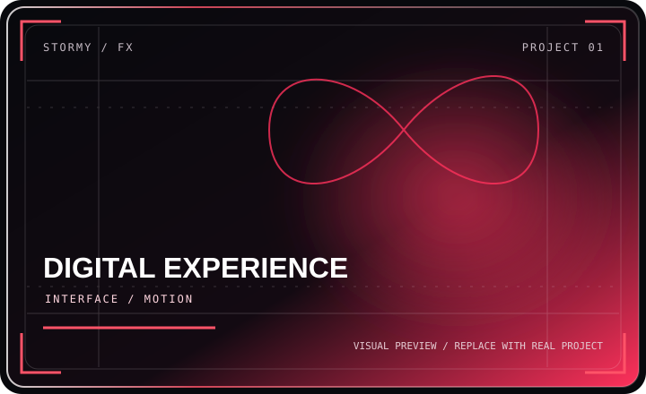
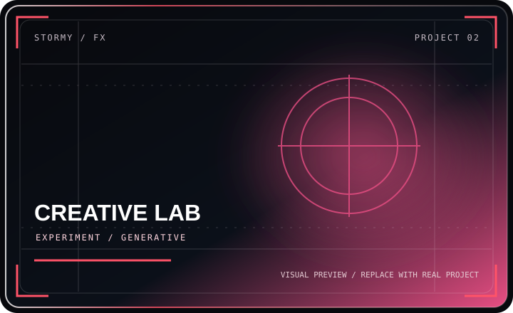
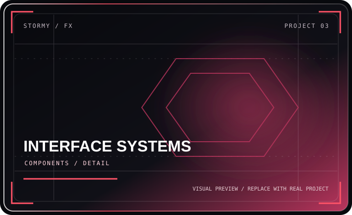
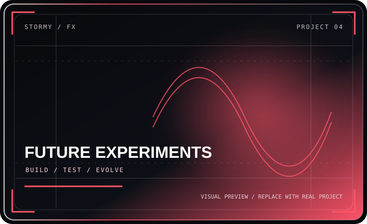

<!-- STORMY FX / CINEMATIC HERO -->

 

---

### `01 / THE CREATIVE SIGNAL`

> **Design with intention. Engineer with precision. Animate with purpose.**

I explore the space where frontend engineering, motion design, and visual storytelling meet — creating responsive interfaces with character, clarity, and detail.

<table>
<tr>
<td width="50%" valign="top">

**◈ DESIGN SYSTEMS**

- Premium interface design
- Responsive layouts
- Visual hierarchy and typography
- Reusable UI components

</td>
<td width="50%" valign="top">

**◈ MOTION ENGINEERING**

- GSAP and scroll storytelling
- Framer Motion interactions
- Parallax and layered depth
- Performance-conscious animation

</td>
</tr>
</table>

### `02 / SELECTED WORLDS`

Consistent frames. Cinematic previews. Real projects over decoration.

<table>
<tr>
<td width="50%" valign="top">

### `01 — Digital Experience`

A home for your strongest website build. Replace this description with the project's real purpose and standout features.

`UI/UX` · `RESPONSIVE` · `INTERACTION`

[↗ View project](https://github.com/vivekananda-school/vivekananda-school)

</td>
<td width="50%" valign="top">

### `02 — Creative Lab`

Showcase an experimental interface, animation system, AI experiment, or visual concept here.

`MOTION` · `EXPERIMENTAL` · `WEB`

[↗ View project](https://github.com/vivekananda-school/vivekananda-school)

</td>
</tr>
<tr>
<td width="50%" valign="top">

### `03 — Interface Systems`

Feature a reusable component library, dashboard, or carefully engineered responsive experience.

`COMPONENTS` · `SYSTEMS` · `DETAIL`

[↗ View project](https://github.com/vivekananda-school/vivekananda-school)

</td>
<td width="50%" valign="top">

### `04 — Future Experiments`

Use this slot for your next release, prototype, or ambitious new idea.

`BUILD` · `TEST` · `EVOLVE`

[↗ View project](https://github.com/vivekananda-school/vivekananda-school)

</td>
</tr>
</table>

### `03 / THE TOOLKIT`

<table>
<tr>
<td width="50%" valign="top">

**FRONTEND**

`HTML` · `CSS` · `JavaScript` · `TypeScript`  
`React` · `Next.js` · `Tailwind CSS`

</td>
<td width="50%" valign="top">

**CREATIVE ENGINEERING**

`GSAP` · `Framer Motion` · `Three.js`  
`Figma` · `Git` · `Vercel`

</td>
</tr>
</table>

### `04 / LIVE TELEMETRY`

<!-- IMPORTANT: Preserve your currently working GitHub statistics and streak image tags.
     Paste the exact  lines that already work for you between these comments.
     Do not replace their usernames with "vivekananda-school" unless that is the correct personal account.
     The repository shown here may be an organization repository. -->

<!-- START YOUR EXISTING WORKING STATS IMAGE TAGS -->

<!-- Paste your currently working GitHub stats card  tag here. -->
<!-- Paste your currently working top-languages  tag here. -->
<!-- Paste your currently working streak card  tag here. -->

<!-- END YOUR EXISTING WORKING STATS IMAGE TAGS -->

### `05 / CONTRIBUTION MATRIX`

<!-- Preserve the exact URL for your currently working snake if it differs. -->

### `06 / TERMINAL — CURRENT FOCUS`

<table>
<tr>
<td width="33%" align="center">

**01 / DESIGN**

Shape the experience

</td>
<td width="34%" align="center">

**02 / ENGINEER**

Build the system

</td>
<td width="33%" align="center">

**03 / EVOLVE**

Refine every detail

</td>
</tr>
</table>

CRAFTED WITH CURIOSITY · ENGINEERED WITH PRECISION

 

STORMY FX — CREATE / REFINE / EVOLVE

